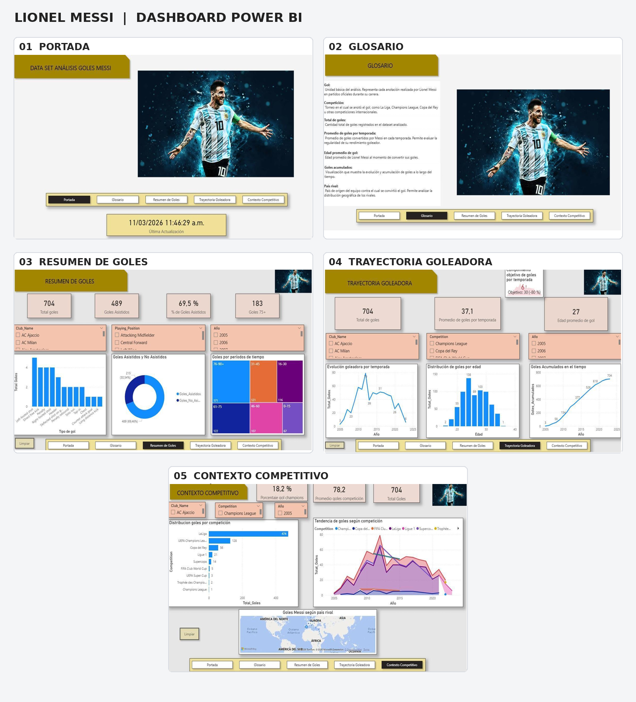

# ⚽ Análisis de Datos Deportivos — Goles de Lionel Messi

**Autor:** Diego Pignocchi  
**Curso:** Data Analytics — Coderhouse  
**Fecha:** Marzo de 2026  
**Herramientas:** Excel, Power Query, Power BI y DAX  
**Fuente de datos:** Kaggle

## 1. Descripción del proyecto

Este proyecto analiza el rendimiento goleador de Lionel Messi en competiciones oficiales de clubes hasta 2023, utilizando un dataset obtenido de Kaggle, posteriormente limpiado, normalizado y organizado para su análisis.

El objetivo es identificar patrones relacionados con las temporadas, las competiciones, la edad del jugador, los minutos de anotación y el contexto competitivo.

## 2. Hipótesis

La hipótesis principal plantea que Lionel Messi tiende a convertir una mayor cantidad de goles durante la segunda mitad de los partidos, especialmente entre los minutos 46 y 75.

## 3. Objetivos

- Analizar la evolución de los goles por temporada.
- Comparar el rendimiento en competiciones nacionales e internacionales.
- Estudiar la distribución de goles según la condición de local o visitante.
- Identificar los períodos de los partidos con mayor frecuencia de anotaciones.
- Analizar los goles según la edad, posición de juego y competición.

## 4. Preparación y modelado de datos

Se realizaron tareas de limpieza, normalización y transformación de datos para construir un modelo relacional.

El modelo incluye las siguientes tablas:

- **Goles:** registro de cada anotación.
- **Partidos:** fechas, temporadas y resultados.
- **Competiciones:** torneos y categorías.
- **Clubes:** equipos participantes.
- **Posiciones:** posiciones de juego.
- **Jugador:** información del futbolista.

En Power BI se incorporaron tablas adicionales de calendario y rivales para facilitar las relaciones y el análisis temporal.

## 5. Indicadores y medidas DAX

Se desarrollaron medidas para calcular:

- Total de goles.
- Goles asistidos y no asistidos.
- Porcentaje de goles asistidos.
- Goles convertidos desde el minuto 75.
- Promedio de goles por temporada.
- Edad promedio al convertir goles.
- Goles acumulados.
- Porcentaje de goles en Champions League.

## 6. Dashboard de Power BI

El dashboard interactivo contiene cinco secciones:

1. **Portada:** presentación y navegación.
2. **Glosario:** definiciones de las principales métricas.
3. **Resumen de goles:** indicadores generales y distribución de anotaciones.
4. **Trayectoria goleadora:** evolución temporal, goles por edad y acumulados.
5. **Contexto competitivo:** competiciones, tendencias y distribución geográfica de rivales.

El dataset analizado registra **704 goles**, de los cuales **489 figuran como asistidos**, según las medidas del proyecto.

## 7. Estructura del repositorio

```text
Coderhouse-data-analytics-messi/
│
├── data/
│   ├── raw/
│   └── processed/
│
├── dashboard/
│
├── docs/
│
├── README.md
└── LICENSE
```

Las carpetas contendrán los datasets originales y normalizados, el archivo de Power BI, las capturas del dashboard y el informe técnico del proyecto.

## 8. Alcance y limitaciones

El análisis comprende los goles registrados en el dataset para competiciones oficiales de clubes hasta 2023. No incluye goles de la selección argentina ni pretende representar estadísticas actualizadas de toda la carrera del jugador.

Los resultados tienen una finalidad académica, descriptiva y exploratoria.

## 9. Vista previa del dashboard



## 10. Fuente y documentación

**Fuente:** Kaggle

**Documentación:** Informe del Proyecto Final de Data Analytics — Coderhouse, marzo de 2026.

---

**Diego Pignocchi**  
*Proyecto Final de Data Analytics — Coderhouse, 2026.*
